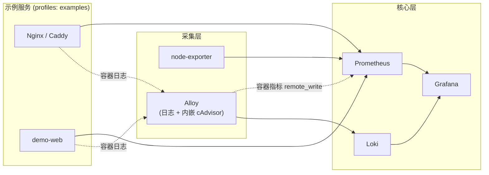

# 可观察性基础设施启动套件

infra-observability-starter 是一个基于 Docker Compose 的开箱即用监控与日志参考栈,集成 Prometheus、Grafana、Alloy、Loki,并提供 Nginx/Caddy、Web 容器及主机指标的采集与日志查看示例,帮助用户快速启动和复用一套基础可观测性基础设施。

## 架构



职责划分:

| 组件 | 职责 |
|------|------|
| Prometheus | 指标存储与查询,接收 Alloy remote_write |
| Alloy | 容器日志采集;内嵌 cAdvisor 容器指标并 remote_write 到 Prometheus;预留 OTLP HTTP 接收端点 |
| Loki | 日志存储与查询 |
| Grafana | 可视化与告警,数据源自动 provisioning |

## 结构

```
infra-observability-starter/
├── compose.yaml                # 唯一入口,include 所有子文件
├── compose.d/
│   ├── core.yaml               # prometheus、grafana
│   ├── logging.yaml            # alloy、loki
│   ├── exporters.yaml          # node-exporter(主机指标;cadvisor 已内嵌进 alloy)
│   └── examples.yaml           # demo-web、nginx + nginx-exporter 或 caddy(二选一)
│                               #   (全部 profiles: ["examples"],按需启动)
├── config/
│   ├── prometheus/             # prometheus.yml、抓取目标
│   ├── grafana/
│   │   ├── provisioning/       # 数据源自动关联 prometheus、loki
│   │   └── dashboards/         # 预置 dashboard JSON
│   ├── loki/                   # loki.yaml(retention、size 上限)
│   └── alloy/                  # 日志采集、内嵌 cAdvisor 与 remote_write 配置
├── examples/
│   ├── demo-web/               # Python 示例应用(自研指标 + JSON 日志)
│   ├── nginx/                  # nginx.conf 与欢迎页(stub_status)
│   └── caddy/                  # Caddyfile 与欢迎页(原生 /metrics)
├── data/                       # 持久化目录(挂载进容器,.gitignore)
├── Makefile                    # up/down/logs/reset 等快捷命令
├── compose.override.yaml       # 本地覆盖(自行创建,不提交)
├── .env.example                # 镜像版本、端口、凭据等变量(带注释)
└── README.md
```

## 设计约定

- **范围**:本版本不含数据库监控(自建/云数据库均不在范围内);后续如需接入,可考虑通过云监控 exporter(如 aliyun-exporter、cloudwatch-exporter)桥接。
- **版本要求**:需 Docker Compose v2.20+,使用 `include` 特性。
- **职责边界**:应用与主机指标由 Prometheus 静态抓取;容器指标由 Alloy 内嵌 cAdvisor 采集后经 remote_write 写入 Prometheus;日志由 Alloy 采集后写入 Loki。
- **profiles**:`examples.yaml` 内所有服务声明 `profiles: ["examples"]`,核心栈默认启动;profiles 必须写在子文件服务上以保证兼容性。
- **网络隔离**:核心与采集层在 `infra_net`;示例服务在 `examples_net`,仅访问端口映射到宿主机,管理端口保持内网。
- **持久化**:数据统一挂载到 `data/`,Prometheus/Loki 配置 retention 与容量上限,防止磁盘写满。
- **安全**:凭据一律经 `.env` 注入,不硬编码;默认密码仅用于演示,启动后建议修改;管理端口默认仅暴露内部网络。
- **版本管理**:镜像版本集中由 `.env` 控制(如 `PROMETHEUS_VERSION`),避免版本漂移。
- **服务发现**:Prometheus 使用静态抓取配置,不再依赖 `docker.sock`;Alloy 通过 `docker.sock` 采集日志与容器元数据,仅保留当前 compose 项目内的容器;socket 路径经 `.env` 的 `DOCKER_SOCKET` 参数化。
- **rootless**:支持 rootless Docker(见 [docs/ROOTLESS.md](docs/ROOTLESS.md));无 `privileged`、无 `pid: host`,Prometheus 非 root 运行。

## 快速开始

```bash
cp .env.example .env           # 按需修改端口与凭据
make up                        # 启动核心栈(需已安装 make)
make up-examples               # 可选:启动示例服务(demo-web + nginx)
# 访问 http://localhost:3000(Grafana,数据源已自动配置)
```

## 常用命令

| 命令 | 说明 |
|------|------|
| `make up` | 启动核心栈与主机指标采集 |
| `make up-examples` | 启动示例服务(demo-web + nginx 变体) |
| `make up-caddy` | 切换为 caddy 变体(自动停掉 nginx 组) |
| `make logs` | 跟踪所有容器日志 |
| `make ps` | 查看容器状态 |
| `make config` | 输出合并后的 compose 配置 |
| `make reset` | 停止全部服务并清空 data/ 数据 |
| `make doctor` | 环境自检(rootless 检测、socket 路径检查) |

> 示例服务为静态抓取目标,未启动时在 Prometheus 目标页显示 DOWN,属预期行为。

## 端口

| 服务 | 端口 | 说明 |
|------|------|------|
| Grafana | 3000 | Web UI |
| Prometheus | 9090 | Web UI / API |
| Loki | 3100 | HTTP API |
| Alloy | 4318 | OTLP HTTP 接收(可选) |
| node-exporter | 9100 | 主机指标(仅内网) |
| nginx / caddy | 8088 | 示例(二选一),演示指标与访问日志 |
| demo-web | 8080 | 示例应用 |
| nginx-exporter | 9113 | stub_status 转 Prometheus 格式(仅内网) |

> 端口均可通过 `.env` 覆盖。

## rootless 运行

- rootless 下在 `.env` 设置 `DOCKER_SOCKET=$XDG_RUNTIME_DIR/docker.sock`(如 `/run/user/1000/docker.sock`),然后 `make doctor` 自检、`make up` 启动。
- 已知差异:node-exporter 部分 collector(温度、hwmon 等)可能降级;内嵌 cAdvisor 的 cgroup 读取受限程度视宿主配置而定。
- 详细方案与限制见 [docs/ROOTLESS.md](docs/ROOTLESS.md)。

## 告警

首版使用 Grafana Alerting(基于 Prometheus/Loki 数据源);如需更复杂的路由与静默,后续可引入 Alertmanager,Alloy 已预留对接位置。

## TODO

- [x] docker rootless:适配 rootless Docker 环境(见 docs/ROOTLESS.md)
- [ ] 通过 docker.sock 采集:替换剩余的 Alloy 日志采集链路(服务发现已改静态;接收端方案待定)
